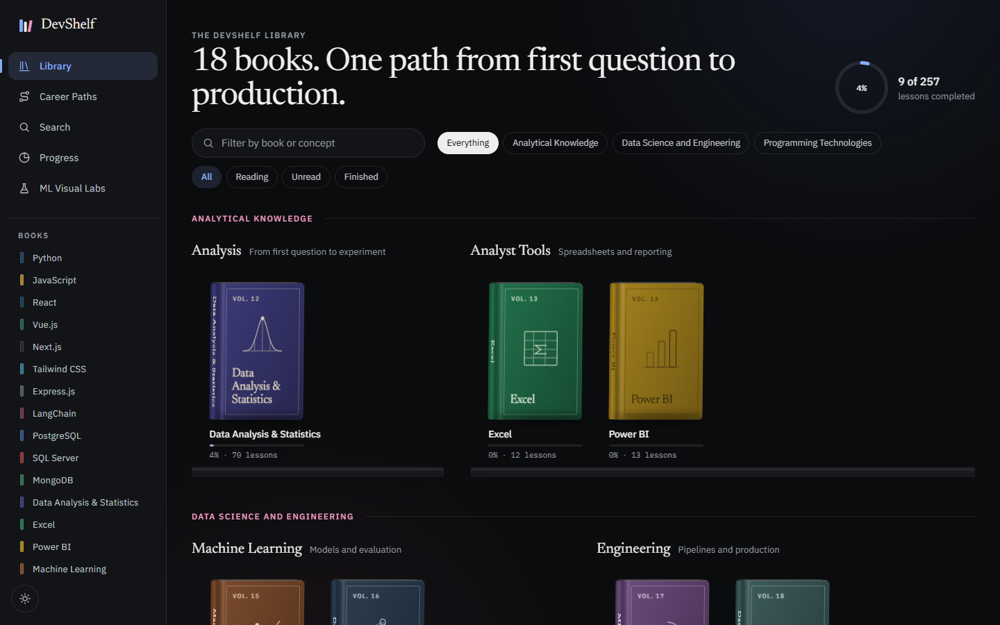
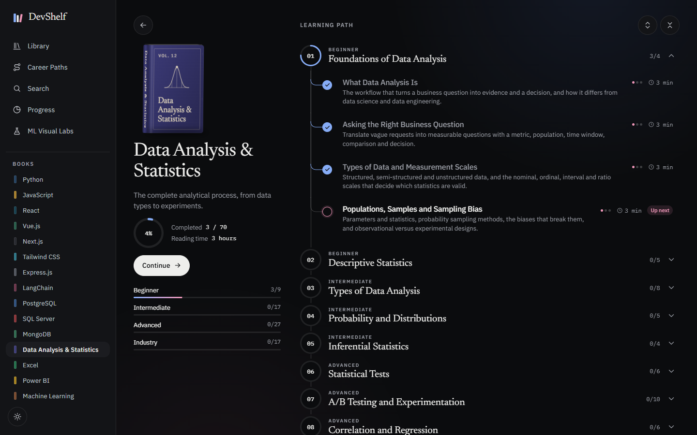
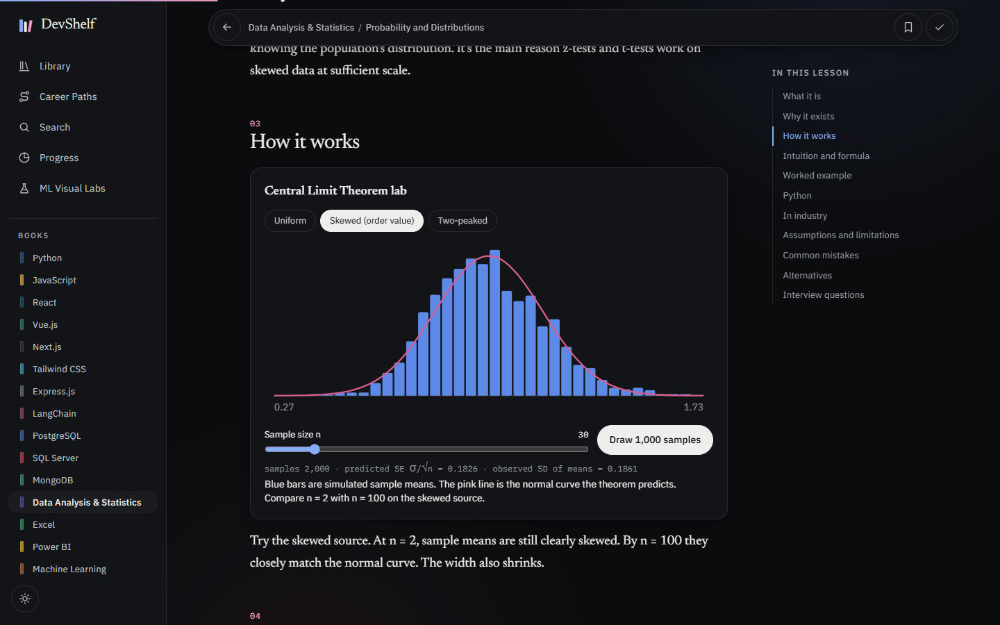
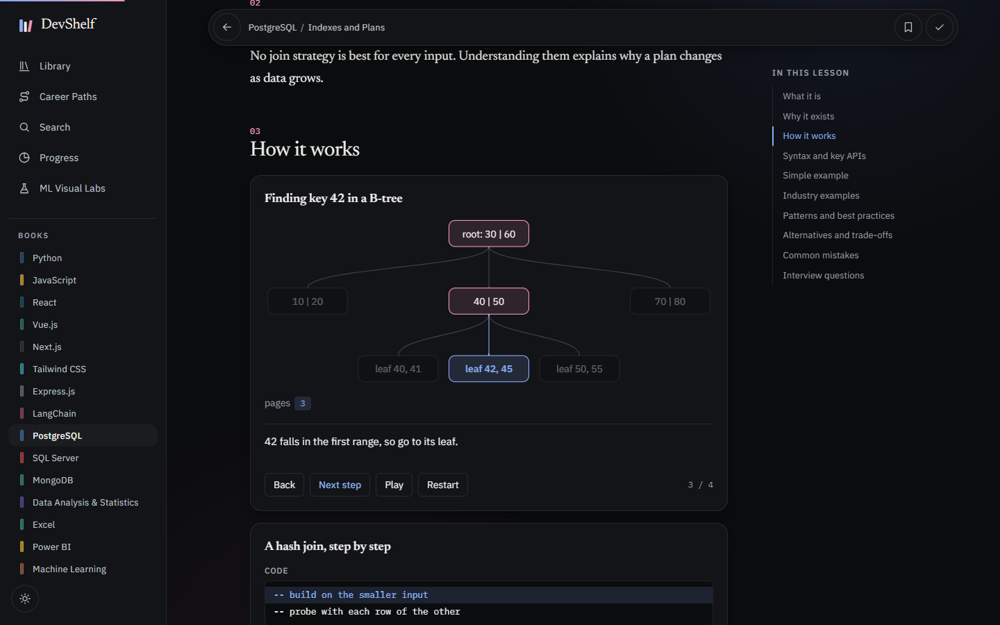
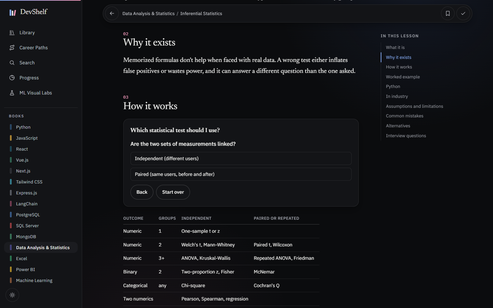
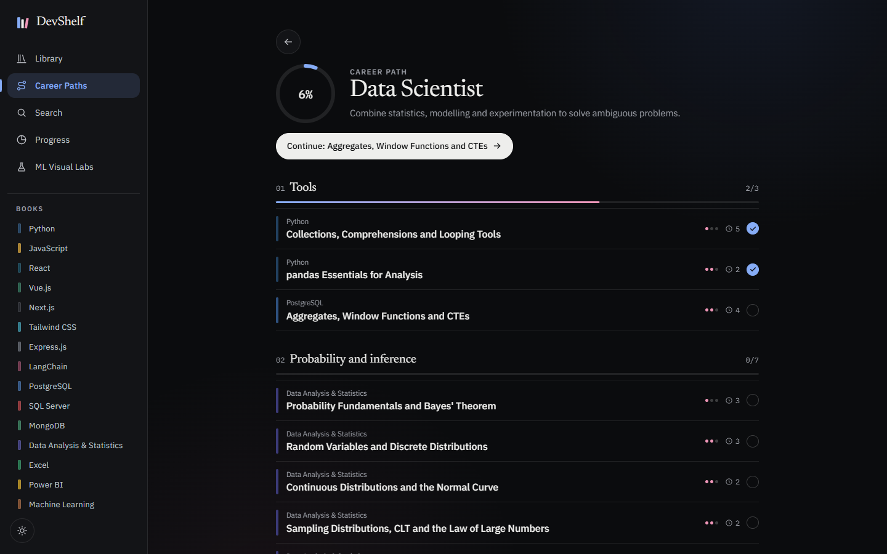
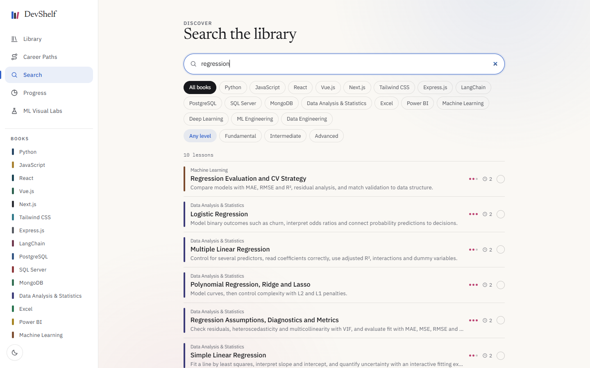
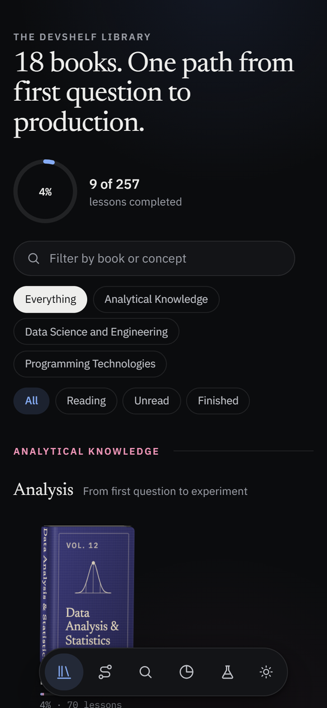
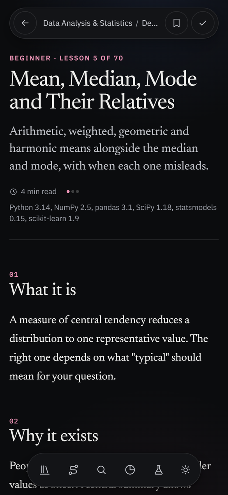

# DevShelf

**A visual-first technical library you read like a bookshelf.** 18 books and 257 lessons, from Python and SQL to statistics, A/B testing, machine learning and MLOps, with interactive diagrams, learning roadmaps and career paths.

No accounts and no backend. Your reading progress and bookmarks stay in your browser.



## What's inside

- **A real bookshelf.** Each subject is a 3D book with its own cover, and opening one plays a short page-turn animation.
- **Learning roadmaps.** Every book is a tree of sections in prerequisite order, with "up next" and "read first" hints.
- **Interactive lessons.** Step through a B-tree lookup, a hash join or the JavaScript event loop instead of reading about them.
- **Statistics labs.** Draw samples to watch the Central Limit Theorem form, tune power and sample size, fit a regression line, and move a classification threshold.
- **A statistical test picker.** Answer a few questions about your data and get the right test, with a link to the lesson.
- **Career paths.** Ordered routes for Data Analyst, Product Analyst, Business Analyst, Data Scientist and ML Engineer. A lesson completed anywhere counts everywhere.
- **Search, bookmarks and progress tracking**, plus light and dark themes and a phone layout.

<table>
  <tr>
    <td width="50%"><br /><sub><b>Learning roadmap</b> with progress by stage</sub></td>
    <td width="50%"><br /><sub><b>Central Limit Theorem lab</b> inside a lesson</sub></td>
  </tr>
  <tr>
    <td width="50%"><br /><sub><b>Step-through diagrams</b> for how things really work</sub></td>
    <td width="50%"><br /><sub><b>Test selector</b> that teaches the choice, not just the formula</sub></td>
  </tr>
  <tr>
    <td width="50%"><br /><sub><b>Career paths</b> across all the books</sub></td>
    <td width="50%"><br /><sub><b>Search</b> by topic, book and level</sub></td>
  </tr>
</table>

<p align="center">
  
  &nbsp;&nbsp;
  
</p>

## The library

| Group | Book | Lessons |
| --- | --- | ---: |
| Analytical Knowledge | Data Analysis & Statistics | 70 |
| | Excel | 12 |
| | Power BI | 13 |
| Data Science and Engineering | Machine Learning | 12 |
| | Deep Learning | 5 |
| | ML Engineering | 6 |
| | Data Engineering | 7 |
| Programming Technologies | Python | 22 |
| | JavaScript | 16 |
| | React | 13 |
| | Vue.js | 10 |
| | Next.js | 10 |
| | Tailwind CSS | 8 |
| | Express.js | 9 |
| | LangChain | 11 |
| | PostgreSQL | 12 |
| | SQL Server | 10 |
| | MongoDB | 11 |

Each lesson follows a consistent structure: what it is, why it exists, how it works, worked examples, real industry use, common mistakes and interview questions, with links to official documentation.

Runnable Python, JavaScript, SQL and MongoDB examples were executed while writing them. Examples that couldn't be run locally, such as DAX, Spark, Airflow, dbt and Docker, were checked against official documentation, and each lesson says how it was tested.

## Built with

Next.js (App Router), React, TypeScript, Tailwind CSS and MDX. Pages are statically generated, the diagrams are hand-written SVG and CSS, and diagrams only load when you reach them.

## Run it locally

You need Node.js 20.9 or newer.

```bash
npm install
```

```bash
npm run dev
```

Then open http://localhost:3000. Press Ctrl+B to collapse the sidebar.

## Project layout

```text
app/          Routes: library, books, lessons, search, progress, career paths
components/   Bookshelf, roadmap, lesson chrome, navigation, visualizations
content/      One folder of MDX lessons per book
lib/          Books, curriculum order, career paths, progress store
public/fonts  Self-hosted Newsreader subset
scripts/      Content validator
```

## Adding a lesson

Create `content/<technology>/<slug>.mdx`. The technology must exist in `lib/technologies.ts`.

```yaml
---
title: "Unique chapter title"
summary: "One or two sentences."
level: intermediate # fundamental | intermediate | advanced
section: functions # a section id from lib/curriculum.ts
order: 20 # position within the section
tags: [tag-one, tag-two]
related: [javascript/event-loop]
requires: [python/functions-and-scope] # optional prerequisites
versions: "What versions this applies to"
tested: "Runtime the examples were executed on"
verified: "2026-11-09"
docs:
  - label: "Official page title"
    url: "https://..."
---
```

Technology chapters use these `##` sections, in this order: What it is, Why it exists, How it works, Syntax and key APIs, Simple example, Industry examples, Patterns and best practices, Alternatives and trade-offs, Common mistakes, Interview questions.

The `statistics`, `machine-learning` and `deep-learning` books use a knowledge template instead: What it is, Why it exists, How it works, Intuition and formula (optional), Worked example, Python, SQL (optional), Excel or Power BI (optional), In industry, Assumptions and limitations, Common mistakes, Alternatives, Interview questions.

MDX components are registered in `components/mdx-components.tsx`: `Callout` (`note`, `warning`, `deprecated`, `version`), `Question`, `Formula`, and the lazily loaded visualizations in `components/viz/`. `StepFlow`, `TreeViz`, `MemoryViz`, `LanesViz` and `TableViz` take their data as props. `DistributionExplorer` (optional `only` list), `CltSimulator`, `HypothesisViz`, `SampleSizeCalculator`, `RegressionViz`, `ThresholdExplorer` and `TestSelector` are self-contained labs.

A new lesson appears in its book's roadmap automatically, and every completion percentage recalculates from the actual lesson count.

## Books and career paths

Books live in `lib/technologies.ts`, grouped into Programming Technologies, Analytical Knowledge, and Data Science and Engineering. Each book's sections are in `lib/curriculum.ts`.

Career paths in `lib/paths.ts` are ordered lists of existing lesson ids, so a lesson is never duplicated. `npm run validate` fails if a path names a lesson that doesn't exist.

## Checks

```bash
npm run validate
```

```bash
npm run validate -- --urls
```

```bash
npm run typecheck
```

```bash
npm run build
```

## Credits

The Newsreader font is used under the SIL Open Font License, included at `public/fonts/OFL.txt`.
